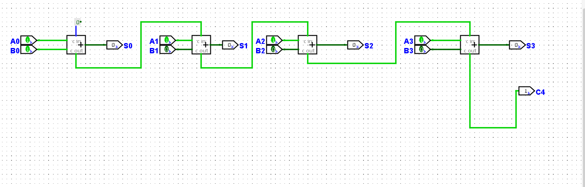
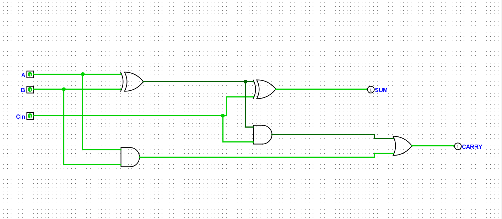
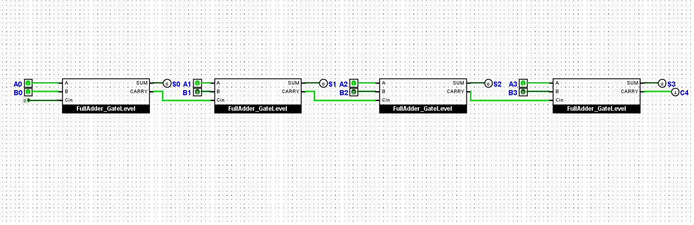
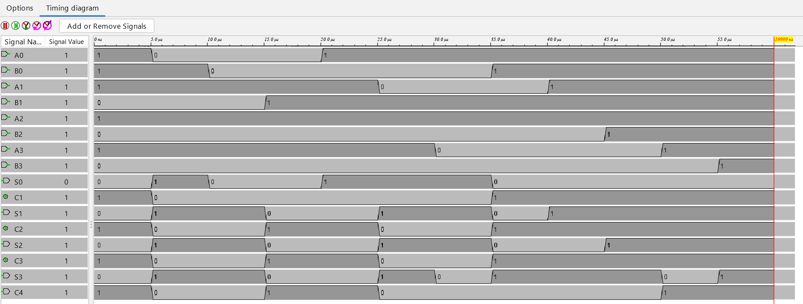

# 4-Bit-Ripple-Carry-Adder
Design and Implementation of 4-Bit Ripple Carry Adder Using Logisim
## Project Overview

This project demonstrates the design and implementation of a 4-Bit Ripple Carry Adder using Logisim.

A Ripple Carry Adder is a digital circuit used to add two 4-bit binary numbers using four Full Adder stages.

## Objectives

1. To design a 4-Bit Ripple Carry Adder.
2. To understand the working of Full Adder circuits.
3. To study carry propagation from one stage to the next.
4. To analyse the effect of carry propagation on circuit delay.

## Software Used

- Logisim

## Main Circuit

The circuit consists of four Full Adders connected in series. Each stage passes its carry output to the next stage.

## Full Adder Circuit

Each Full Adder takes two input bits and one carry input and produces a Sum and Carry output.

## 4-Bit Ripple Carry Adder

The four Full Adder stages are connected together to perform 4-bit binary addition.

## Timing Diagram and Delay Analysis

The timing diagram shows the changes in input, sum and carry signals. It helps us understand how carry propagates through the four stages and affects circuit delay.

## Conclusion

The 4-Bit Ripple Carry Adder was successfully designed and tested in Logisim. This project demonstrates binary addition and the effect of carry propagation on circuit delay.
